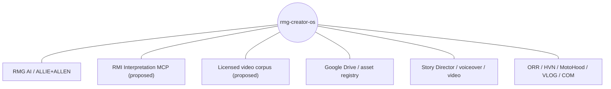

# RMG Creator OS / Master Atelier center — PIAAR Dependency Atlas
**Status:** proposed documentation mirror, pending RPS atlas review. **Source of authority:** [RPS dependency atlas draft PR #84](https://github.com/RMoor-Industries-Ltd-Co/rmg-piaar-system/pull/84).

## The repo as the center of its ecosystem
The canonical graph is held in RPS; this file provides an entrypoint, not an independent registry.

## Impact and governance boundaries
- Production recipes orchestrate creative intake, scripts, media and delivery
- Topic research and media analysis must preserve source evidence and licensing
- Publication authority remains distinct from asset generation

Follow the [RPS **repository-centered maps**](https://github.com/RMoor-Industries-Ltd-Co/rmg-piaar-system/blob/docs/universe-dependency-atlas-v1/docs/atlas/REPO_CENTRIC_MAPS.md), [universe overview](https://github.com/RMoor-Industries-Ltd-Co/rmg-piaar-system/blob/docs/universe-dependency-atlas-v1/docs/atlas/UNIVERSE_OVERVIEW.md), [creator video-to-publication feature lineage](https://github.com/RMoor-Industries-Ltd-Co/rmg-piaar-system/blob/docs/universe-dependency-atlas-v1/docs/atlas/CREATOR_PIPELINE_LINEAGE.md), [typed relationships](https://github.com/RMoor-Industries-Ltd-Co/rmg-piaar-system/blob/docs/universe-dependency-atlas-v1/docs/atlas/relationships.json), and [impact/contract methodology](https://github.com/RMoor-Industries-Ltd-Co/rmg-piaar-system/blob/docs/universe-dependency-atlas-v1/docs/atlas/GOVERNANCE_AND_IMPACT.md).

Changes to shared schemas, MCP identities, asset rights, licensing, publication approvals, or research-to-trade boundaries must reference the affected RPS edges and obtain review before deployment. These links are conceptual until supported by runtime evidence. Documentation only; no licensing, authority, secrets, code or deployment changes.
